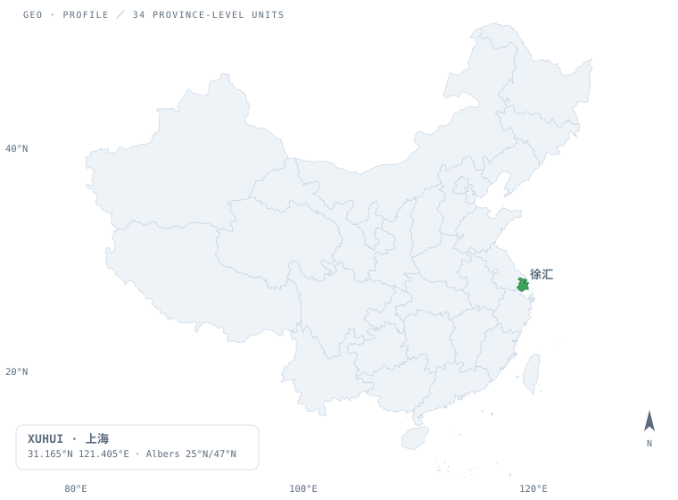
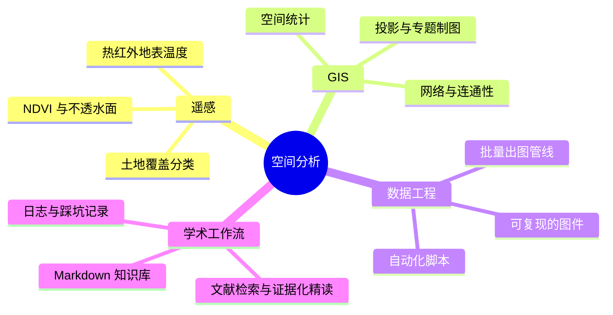

<!--
  ┌──────────────────────────────────────────────────────────────────────────┐
  │  Zane Zhang · GitHub Profile README                                      │
  │                                                                          │
  │  本文件依赖同目录下的 assets/ 与 tools/，请一起提交：                      │
  │    README.md  assets/china-map-{light,dark}.svg                           │
  │               assets/satellite-{light,dark}.svg                          │
  │    tools/build_map.py  tools/build_satellite.py  geo/index.html          │
  │                                                                          │
  │  仓库名必须是 zhangyx0803（和你用户名同名），首页才会显示这份 README。      │
  │  需要你补的只有 2 处，正文里标了「改我」：① 邮箱 ② 项目链接。               │
  └──────────────────────────────────────────────────────────────────────────┘
-->

  

<h1 align="center">Hi there, I'm Zane Zhang 👋</h1>

  <b>A GISer in Shanghai</b> 🌍 地理信息科学 · 空间分析 · 遥感与城市气候

  <code>31.1650°N  121.4050°E</code> — <a href="https://www.openstreetmap.org/?mlat=31.1650&mlon=121.4050#map=15/31.1650/121.4050">上海 · 徐汇</a> · UTC+8 · 海拔 ≈ 4 m

  
  
  

  <a href="https://www.openstreetmap.org/?mlat=31.1650&mlon=121.4050#map=4/34.5/108.0" title="在 OpenStreetMap 上打开这个位置">
    <picture>
      <source media="(prefers-color-scheme: dark)" srcset="assets/china-map-dark.svg">
      
    </picture>
  </a>

  33 个省级单元 · Albers 等积圆锥投影（25°N / 47°N，中央经线 105°E）· 由 <a href="tools/build_map.py">tools/build_map.py</a> 生成 · 点图跳 OSM

  <a href="https://www.openstreetmap.org/?mlat=31.1650&mlon=121.4050#map=16/31.1650/121.4050" title="在 OpenStreetMap 上打开这个位置">
    <picture>
      <source media="(prefers-color-scheme: dark)" srcset="assets/satellite-dark.svg">
      
    </picture>
  </a>

---

### 🕵️‍♂️ About Me / 关于我

> *Navigating the world of Geospatial Data. / 在空间数据的海洋里疯狂迷路。*

- 🎓 **Education:** Geographic Information Science.
   **教育背景**：地理信息科学专业（本科）。
  <!-- 原来那句写了「上海师范大学」，按你这次的选择正文里先不写校名；想加回来就把上面这句改成「上海师范大学，地理信息科学专业」。 -->

- 🔭 **What I do here:** This repo is mainly for my **Research Codes** and **Daily/Academic Logs**.
   **这个主页用来干嘛**：存放我的**科研代码**和**日常/学术日志**。欢迎交流，但请原谅我偶尔粗糙的代码质量。

- 🌱 **I'm currently learning:** Spatial Analysis, Machine Learning.
   **我正在努力搞懂**：空间分析、机器学习算法。

- 🤔 **My daily confusion:** Why is this geographic coordinate always offset?!
   **我的日常疑惑**：为什么这个地理坐标又偏移了？！为什么这段代码昨天还能跑，今天就不行了？

- 💬 **Ask me about:** GIS, Cartography, or Sci-Fi, Music.
   **随时可以找我聊**：地理信息、地图制图、科幻小说、或者音乐。

- ⚡ **Fun fact:** I can read maps but can still get lost in the mall.
   **一个冷知识**：我虽然会画地图、懂 GIS，但在商场里依然会迷路。

---

### 🛰 一次空间分析，长这样

从一张影像到一条结论，中间隔着这么几步（可以展开看）：

<b>▸ 展开：我最常用的技能树</b>

 

<b>▸ 展开：这张地图是怎么画出来的（可复现）</b>

 

- 地图不是截图，是**脚本生成的 SVG**：读取省级行政区 GeoJSON → 手写 Albers 等积圆锥投影 → Douglas–Peucker 抽稀 → 输出浅色 / 深色两套，靠 `<picture>` 与 `prefers-color-scheme` 自动跟随 GitHub 的深浅色主题。
- 徐汇那个点不是贴上去的图标，而是按 `31.1650, 121.4050` 投影算出来的真实位置，外面套了一个 `<animate>` 呼吸环。
- 下面那块卫星面板原本是写在 README 里的内联 `<svg>`——GitHub 会把它过滤掉，所以现在改为独立文件 `assets/satellite-*.svg`，雷达才转得起来。
- 想换成别的坐标：只改 `tools/build_map.py` 与 `tools/build_satellite.py` 顶部的常量，重跑一次即可。

---

### 🧭 想要一张能拖动的？

`geo/index.html` 是一页单文件 Leaflet 地图：可切换街道 / 卫星 / 地形三种底图，鼠标移动实时读出经纬度，
点击任意位置落一个坐标点；徐汇外围画了 5 km 的圈，外加 30°N、120°E 两条准星线，用来看「一度到底有多远」。

部署：仓库 **Settings → Pages → Source: Deploy from a branch → main / root**，
然后访问 `https://zhangyx0803.github.io/zhangyx0803/geo/`。

---

### 🛠️ Tech Stack / 技能树

> *Weapons of choice for Geospatial Science. / 空间科学的趁手兵器。*

  
  
  
  
  

---

### 📁 Repository Focus / 仓库内容

- 🧪 **Research Codes**：处理遥感影像、空间插值、或数据挖掘的脚本与算法。*(主要语言：R / C++)*
- 📝 **Logs**：记录踩过的坑、科研进展、或者突然迸发的灵感。
- 🗺 **Cartography**：做完的图、做废的图，以及它们之间的差别。 <!-- 改我 ②：有具体项目后在这里加 `- [项目名称](链接)` -->

---

### 📊 GitHub Stats / 战况面板

  
  

  

<!-- 两张 vercel 卡片偶尔会限流（很常见），加载不出来就删掉那一行，不影响其他内容 -->

---

### 🤝 Connect with me / 如何联系我

  
  <!-- 改我 ①：把上面的 你的邮箱@example.com 换成真实邮箱 -->

  <i>"Everything is related to everything else, but near things are more related than distant things."</i>
   
  <i>"地理学第一定律：世间万物皆有联系，但距离近的事物联系更为紧密。 —— Waldo Tobler"</i>

  地图由 <code>tools/</code> 下的脚本生成 · 数据：DataV 行政区划 · 投影：Albers 25°N/47°N

