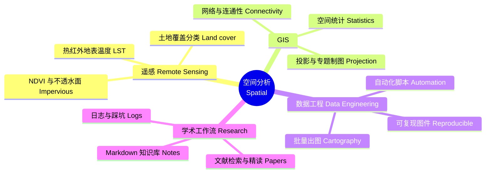
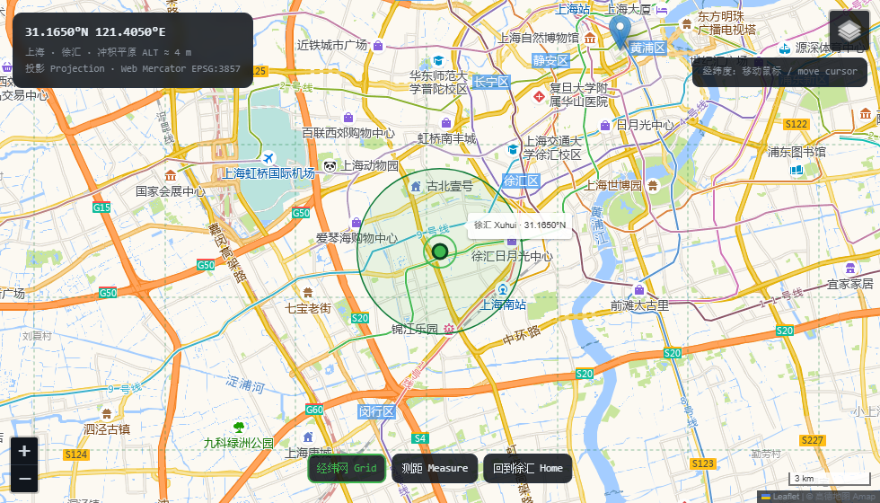

<!--
  ┌──────────────────────────────────────────────────────────────────────────┐
  │  Zane Zhang · GitHub Profile README  ·  中英双语 / bilingual              │
  │                                                                          │
  │  文件依赖 / Dependencies:                                                 │
  │    README.md                                                             │
  │    assets/geo-atlas-{light,dark}.svg      三尺度定位图 / locator plate     │
  │    assets/satellite-{light,dark}.svg      卫星链路面板 / link panel        │
  │    data/china.json  data/shanghai.json    边界数据 / boundaries            │
  │    geo/index.html                         Leaflet 交互地图 / interactive   │
  │    tools/build_atlas.py                   重新生成地图 / regenerate map    │
  │                                                                          │
  │  仓库名必须与用户名同名 zhangyx0803，首页才会显示本文件。                   │
  │  The repo must be named after the account (zhangyx0803) for this to show.  │
  │                                                                          │
  │  需要你填的两处 / two things to fill in: ① 邮箱 email ② 项目链接 links     │
  └──────────────────────────────────────────────────────────────────────────┘
-->

  

<h1 align="center">Hi, I'm Zane Zhang 👋</h1>

  <b>A GISer in Shanghai</b> · <b>坐标上海的地理信息科学学生</b> 
  GIS · Spatial Analysis · Remote Sensing &amp; Urban Climate 
  地理信息科学 · 空间分析 · 遥感与城市气候

  <code>31.1650°N  121.4050°E</code> — <a href="https://www.openstreetmap.org/?mlat=31.1650&mlon=121.4050#map=15/31.1650/121.4050">上海 · 徐汇 Shanghai</a> · UTC+8 · ALT ≈ 4 m

  
  
  

  <a href="https://www.openstreetmap.org/?mlat=31.1650&mlon=121.4050#map=13/31.1650/121.4050" title="在 OpenStreetMap 打开 / open in OSM">
    <picture>
      <source media="(prefers-color-scheme: dark)" srcset="assets/geo-atlas-dark.svg">
      
    </picture>
  </a>

  图 1｜同一投影、三个尺度：中国 → 长江三角洲 → 上海市域 · <i>Fig. 1 — one projection, three scales: China → Yangtze River Delta → Shanghai</i>

  <a href="https://www.openstreetmap.org/?mlat=31.1650&mlon=121.4050#map=4/34.5/108.0">① 中国 China</a> ·
  <a href="https://www.openstreetmap.org/?mlat=31.1650&mlon=121.4050#map=7/31.6/120.2">② 长江三角洲 Yangtze Delta</a> ·
  <a href="https://www.openstreetmap.org/?mlat=31.1650&mlon=121.4050#map=13/31.1650/121.4050">③ 上海市域 Shanghai</a>
   
  点图或点这里看真实底图 / click the figure or these links for the real basemap

  <a href="https://www.openstreetmap.org/?mlat=31.1650&mlon=121.4050#map=16/31.1650/121.4050">
    <picture>
      <source media="(prefers-color-scheme: dark)" srcset="assets/satellite-dark.svg">
      
    </picture>
  </a>

---

### 🕵️‍♂️ About Me / 关于我

> *Navigating the world of Geospatial Data.*
> *在空间数据的海洋里疯狂迷路。*

- 🎓 **Education** — Geographic Information Science, undergraduate.
   **教育背景** — 地理信息科学专业（本科）。
  <!-- 原句写了「上海师范大学」，按你的选择正文先不写校名；想加回来改这一行即可。 -->

- 🔭 **What this profile is for** — research code and daily/academic logs.
   **这个主页用来干嘛** — 存放**科研代码**与**日常/学术日志**。欢迎交流，也请原谅我偶尔粗糙的代码质量。

- 🌱 **Currently learning** — spatial analysis, machine learning.
   **正在努力搞懂** — 空间分析、机器学习算法。

- 🤔 **Daily confusion** — why is this coordinate offset again?
   **日常疑惑** — 为什么这个坐标又偏移了？为什么这段代码昨天还能跑？

- 💬 **Ask me about** — GIS, cartography, sci-fi, music.
   **随时可以聊** — 地理信息、地图制图、科幻小说、音乐。

- ⚡ **Fun fact** — I can read maps and still get lost in a mall.
   **冷知识** — 我会画地图、懂 GIS，但在商场里依然会迷路。

---

### 🛰 One Analysis, End to End / 一次完整分析

*From one image to one conclusion. / 从一张影像到一条结论。*

<b>▸ Skill tree / 技能树</b>

 

<b>▸ How this figure is made / 这张图怎么画的</b>

 

- **One projection, three viewports.** Albers equal-area conic (25°N / 47°N, central meridian 105°E) is applied once; the three panels differ only in extent, so scales stay honest.
   **同一投影、三个视口**：Albers 等积圆锥（25°N/47°N，中央经线 105°E）只算一次，三幅图只改范围，比例尺不变形。
- **Cartographic furniture**, not decoration: neatlines, graticule with degree ticks, scale bars with representative fractions (1:38.6M / 1:8.5M / 1:1.9M), a legend, and zoom callouts linking one panel to the next.
   **图廓、经纬网、比例尺（含 1:38.6M / 1:8.5M / 1:1.9M）、图例、放大框**——都是制图要素，不是贴纸。
- **Theme aware**: `<picture>` + `prefers-color-scheme` serves the dark plate on GitHub dark mode.
   **深浅色自适应**：`<picture>` 与 `prefers-color-scheme` 自动换暗色版。
- Regenerate: `python tools/build_atlas.py` (data in `data/`). Change `CAMPUS` to move the dot.
   重新生成：`python tools/build_atlas.py`；改 `CAMPUS` 就能挪点位。

<b>▸ Satellite link panel / 卫星链路面板</b>

 

The animated radar panel below the map started as an inline `<svg>` — which GitHub strips. It now ships as a standalone file, so the sweep actually runs.
 地图下方的雷达面板最初写成内联 `<svg>`，会被 GitHub 过滤掉；现在改为独立文件，雷达才真的在转。

---

### 🧭 Interactive Map / 交互地图

  

  上方为交互页实机截图，点开可拖动 / screenshot of the live page — click to open it

`geo/index.html` is a single-file Leaflet map — no build step, no API key.
 `geo/index.html` 是一页单文件的 Leaflet 地图，不需要构建、不需要 Key。

| Tool / 工具 | What it does / 作用 |
| --- | --- |
| 经纬网 Grid | draws a live graticule, 0.1° → 0.02° → 0.005° as you zoom / 随缩放自动加密的经纬网 |
| 测距 Measure | click points to measure great-circle distance / 点两点测大圆距离 |
| 回到徐汇 Home | jumps back to 31.1650°N, 121.4050°E / 一键回到点位 |
| 图层 Layers | streets ↔ satellite imagery / 街道与卫星影像切换 |
| 读数 Readout | live lat/lon under the cursor / 鼠标实时经纬度 |

Enable it: **Settings → Pages → Deploy from a branch → `main` / `(root)`**, then open
`https://zhangyx0803.github.io/zhangyx0803/geo/`.
 开启方式：仓库 **Settings → Pages → main / (root)**，之后访问上面的地址。

---

### 🛠 Tech Stack / 技术栈

> *Weapons of choice for Geospatial Science. / 空间科学的趁手兵器。*

  
  
  
  
  

---

### 📁 What's Here / 仓库内容

- 🧪 **Research code** — scripts for remote-sensing imagery, spatial interpolation, data mining. *(R / C++)*
   **研究代码** — 遥感影像处理、空间插值、数据挖掘的脚本与算法。
- 📝 **Logs** — pitfalls hit, progress made, ideas that arrived at 2 a.m.
   **日志** — 踩过的坑、科研进展、半夜迸发的灵感。
- 🗺 **Cartography** — maps that worked, maps that didn't.
   **制图** — 做完的图、做废的图，以及它们之间的差别。
  <!-- 有具体项目后在这里补 `- [项目名称](链接)` / add project links here -->

---

### 📊 GitHub Stats / 数据面板

  
  

  

<!-- vercel 卡片偶尔限流 / occasionally rate-limited — safe to delete these two lines -->

---

### 🤝 Connect / 联系我

  
  <!-- 改我 ①：换成真实邮箱 / replace with your real address -->

  <i>"Everything is related to everything else, but near things are more related than distant things."</i>
   
  <i>“地理学第一定律：世间万物皆有联系，但距离近的事物联系更紧密。” — Waldo Tobler</i>

  Figure generated by <code>tools/build_atlas.py</code> · Data: DataV.GeoAtlas · Projection: Albers 25°N/47°N · WGS 84
   
  图由脚本生成 · 数据 DataV.GeoAtlas · 投影 Albers · 基准 WGS 84

