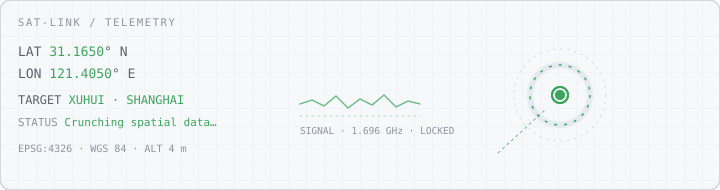

  

<h1 align="center">Hi, I'm Zane Zhang 👋</h1>

  <b>A GISer in Shanghai</b> · <b>坐标上海的地理信息科学学生</b> 
  GIS · Spatial Analysis · Remote Sensing &amp; Urban Climate 
  地理信息科学 · 空间分析 · 遥感与城市气候

  <code>31.1650°N  121.4050°E</code> — <a href="https://www.openstreetmap.org/?mlat=31.1650&mlon=121.4050#map=15/31.1650/121.4050">上海 · 徐汇 Shanghai</a> · UTC+8 · ALT ≈ 4 m

  
  
  

  <a href="https://www.openstreetmap.org/?mlat=31.1650&mlon=121.4050#map=13/31.1650/121.4050" title="在 OpenStreetMap 打开 / open in OSM">
    <picture>
      <source media="(prefers-color-scheme: dark)" srcset="assets/geo-atlas-dark.svg">
      
    </picture>
  </a>

  图 1｜同一投影、三个尺度：中国 → 长江三角洲 → 上海市域 · <i>Fig. 1 — one projection, three scales: China → Yangtze River Delta → Shanghai</i>

  <a href="https://www.openstreetmap.org/?mlat=31.1650&mlon=121.4050#map=4/34.5/108.0">① 中国 China</a> ·
  <a href="https://www.openstreetmap.org/?mlat=31.1650&mlon=121.4050#map=7/31.6/120.2">② 长江三角洲 Yangtze Delta</a> ·
  <a href="https://www.openstreetmap.org/?mlat=31.1650&mlon=121.4050#map=13/31.1650/121.4050">③ 上海市域 Shanghai</a>
   
  点图或点这里看真实底图 / click the figure or these links for the real basemap

  <a href="https://www.openstreetmap.org/?mlat=31.1650&mlon=121.4050#map=16/31.1650/121.4050">
    <picture>
      <source media="(prefers-color-scheme: dark)" srcset="assets/satellite-dark.svg">
      
    </picture>
  </a>

---

### 🕵️‍♂️ About Me / 关于我

> *Navigating the world of Geospatial Data.*
> *在空间数据的海洋里疯狂迷路。*

- 🎓 **Education** — Geographic Information Science, undergraduate.
   **教育背景** — 地理信息科学专业（本科）。

- 🔭 **What this profile is for** — research code and daily/academic logs.
   **这个主页用来干嘛** — 存放**科研代码**与**日常/学术日志**。欢迎交流，也请原谅我偶尔粗糙的代码质量。

- 🌱 **Currently learning** — spatial analysis, machine learning.
   **正在努力搞懂** — 空间分析、机器学习算法。

- 🤔 **Daily confusion** — why is this coordinate offset again?
   **日常疑惑** — 为什么这个坐标又偏移了？为什么这段代码昨天还能跑？

- 💬 **Ask me about** — GIS, cartography, sci-fi, music.
   **随时可以聊** — 地理信息、地图制图、科幻小说、音乐。

- ⚡ **Fun fact** — I can read maps and still get lost in a mall.
   **冷知识** — 我会画地图、懂 GIS，但在商场里依然会迷路。

---

### 🔬 Research / 科研成果

> 只公开**项目说明与方法/代码**；论文原文、图件与原始数据均不公开。
> *Project overviews and code only — manuscripts, figures and raw data stay private.*

| 项目 Project | 在回答什么 Question | 方法与栈 Methods & stack |
| --- | --- | --- |
| **[上海市冷岛网络演变（2015–2025）](https://github.com/zhangyx0803/shanghai-cool-island-network)** *Shanghai Cool-Island Network* | 冷岛网络十年间怎么变、变化源于源地还是阻力面、先修哪里 | MSPA · MCR · 电路理论 · 2×2 析因分解 · 熵权法 · ArcGIS Pro |
| **[乌镇东栅 / 西栅 游客情感对比](https://github.com/zhangyx0803/wuzhen-twin-gate-sentiment)** *Wuzhen Twin-Gate Sentiment* | 同一古镇两栅的游客体验差异，集中在哪些维度、如何随时间变化 | 点评采集 · 中文 NLP · 主题分类 · 随机森林 + SHAP · MWU + FDR |

---

### 🛠 Tech Stack / 技术栈

> *Weapons of choice for Geospatial Science. / 空间科学的趁手兵器。*

  
  
  
  
  

---

### 📁 What's Here / 仓库内容

- 🧪 **Research code** — scripts for remote-sensing imagery, spatial interpolation, data mining. *(R / C++)*
   **研究代码** — 遥感影像处理、空间插值、数据挖掘的脚本与算法。
- 📝 **Logs** — pitfalls hit, progress made, ideas that arrived at 2 a.m.
   **日志** — 踩过的坑、科研进展、半夜迸发的灵感。
- 🗺 **Cartography** — maps that worked, maps that didn't.
   **制图** — 做完的图、做废的图，以及它们之间的差别。

---

### 📊 GitHub Stats / 数据面板

  
  

  

---

### 🤝 Connect / 联系我

  

  <i>"Everything is related to everything else, but near things are more related than distant things."</i>
   
  <i>“地理学第一定律：世间万物皆有联系，但距离近的事物联系更紧密。” — Waldo Tobler</i>

  Figure generated by <code>tools/build_atlas.py</code> · Data: DataV.GeoAtlas · Projection: Albers 25°N/47°N · WGS 84
   
  图由脚本生成 · 数据 DataV.GeoAtlas · 投影 Albers · 基准 WGS 84

